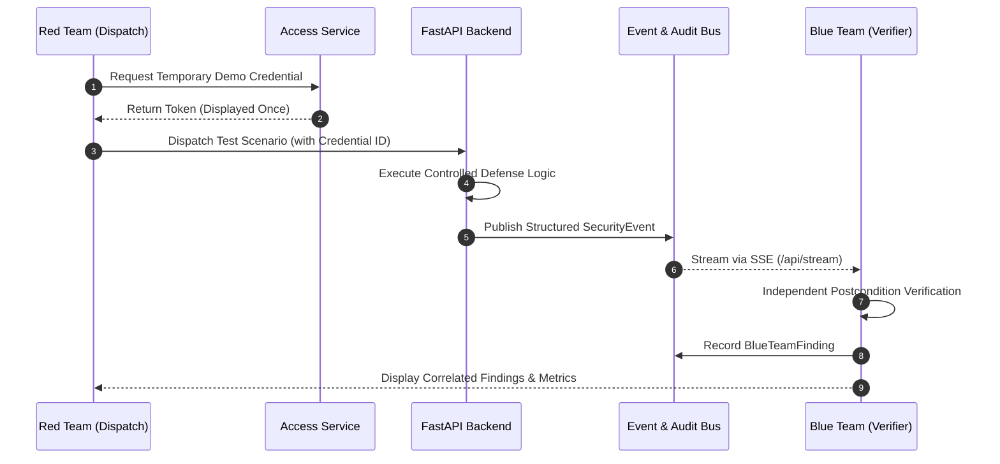

# Red Team & Blue Team Operational Workflow

## 1. Unified Architecture
In ZeroTrace, Red Team and Blue Team are not disconnected pages. They share:
- The authoritative FastAPI backend state.
- The shared event bus and audit trail (`event_service.py`).
- Real-time Server-Sent Events (SSE) stream (`/api/stream`).
- URL query-parameter navigation (`?view=red` and `?view=blue`).

---

## 2. Shared Operational Sequence

---

## 3. Scoped Temporary Demonstration Credential

To govern privileged operations in the software test environment, Red Team can generate a temporary token:
- **Label**: `TEMPORARY DEMO ENVIRONMENT CREDENTIAL — NOT A HARDWARE JTAG PASSWORD`
- **Entropy**: 256-bit cryptographically secure random value (`secrets.token_urlsafe(32)`).
- **Storage**: Only the SHA-256 hash is retained in memory.
- **Privacy**: The plaintext token is displayed once upon creation and never exposed in event streams or logs.
- **Safety Policy**: The token cannot authorize physical silicon destruction or irreversible eFuse modification.
